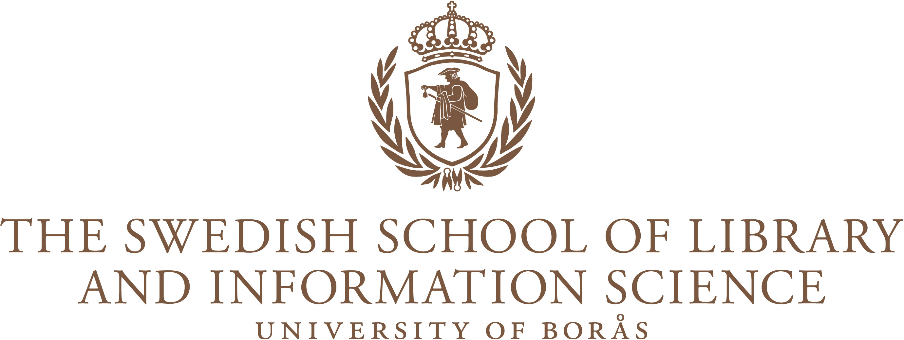
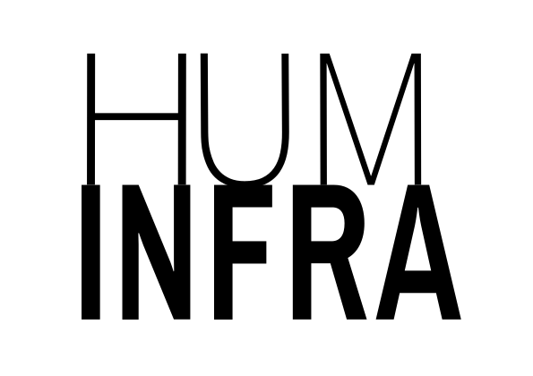
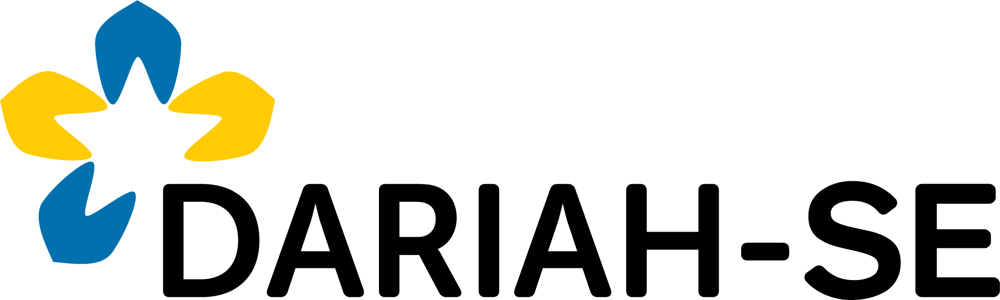

# re:late

## About

These training materials were developed by Wout Dillen as part of the Controlled Vocabularies course (Kontrollerade vokabulärer) taught at the [University of Borås](www.hb.se), Sweden. They are designed to give students a better understanding of the concept of Linked Open Data through a hands-on exercise where they express relations between objects and entities in `.rdf`, and visualise the result. 

In the workshop re:late was designed for, students are split into groups, where each group is given a physical music record to describe in RFD tuples. At the end of the workshop, students upload their descriptions, which are then merged to visualise the links between the records with [RDF Grapher](). The workshop instructions and the python code to merge the files and visualise them are made available through a Jupyter Book hosted on GitHub.

## Website Link

🚀 Visit the re:late website here: [https://sslis.github.io/relate/](https://sslis.github.io/relate/).

## Affiliations

This resource was developed during Wout's employment at the University of Borås and is affiliated to [Huminfra](https://www.huminfra.se), the Swedish national infrastructure supporting digital and experimental research in the Humanities. In that capacity, it is developed as an in-kind contribution to [DARIAH-SE](https://www.huminfra.se/dariah), the Swedish national node of [DARIAH-EU](https://www.dariah.eu) (Digital Research Infrastructure for the Arts and Humanities), a Pan-European infrastructure that supports digital research and collaboration in the arts and humanities.

## Technical aspects

This resource is designed as a [Jupyter Book](https://jupyterbook.org) that uses the programming language [python](https://www.python.org) to merge student-uploaded `.rdf` files, and visualise them with [RDF Grapher](https://www.ldf.fi/service/rdf-grapher), a linked data visualisation tool developed by [Linked Data Finland](https://www.ldf.fi), part of [FIN-CLARIAH](https://seco.cs.aalto.fi/projects/fin-clariah/).

